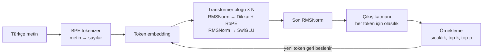
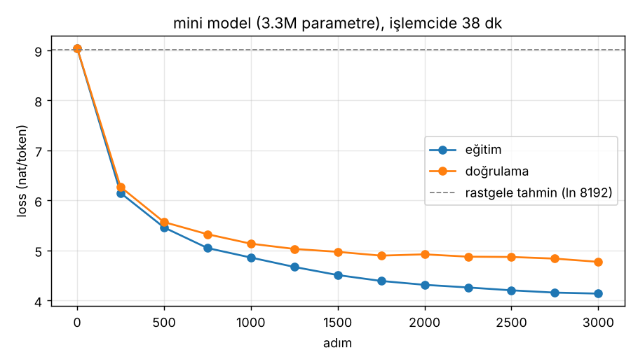

# Türkçe GPT

Sıfırdan yazılmış, Türkçe metinle eğitilen küçük bir dil modeli. Hazır bir yapay zekâ servisine bağlanmıyor; tokenizer'dan transformer'a, eğitim döngüsünden sohbet ekranına kadar her parça bu depoda, PyTorch ile elle yazıldı. ChatGPT gibi modellerin nasıl çalıştığını küçük ölçekte baştan sona gösteriyor.

```
$ python -m turkce_gpt uret --model modeller/mini/model.pt --baslangic "Türkiye'nin" --tohum 7
Türkiye'nin ikinci bir tarafına sahip olan Bay Pirentt'in "kızgınlık" için bir radikal daha
çok şey yoktu. İşletme: "Yanlış yönlendirme," dedi. Şirket, tüm mali açıdan uygun bir
şekilde desteklediği umutlu bir şekilde fiyatlandırıldı
```

Bu çıktı, 3.3 milyon parametrelik `mini` modelin normal bir işlemcide 38 dakikada, yaklaşık 1 milyon Türkçe token ile eğitilmesinden sonra alındı. Ekleri ve cümle yapısını öğrenmiş, ama anlamı henüz tutarsız; bu boyuttaki bir modelden beklenen tam olarak bu.

## Neler var?

| Parça | Dosya | Ne yapıyor |
|---|---|---|
| Tokenizer | `turkce_gpt/tokenizer.py` | Byte düzeyinde BPE. Türkçe ekleri kendisi öğrenir: `evlerimizden` → ` ev` + `lerimiz` + `den` |
| Veri hazırlama | `turkce_gpt/data.py` | Metni indirir, temizler, tokenizer'ı eğitir, tokenleri `.bin` dosyalarına yazar |
| Model | `turkce_gpt/model.py` | Llama tarzı GPT: RMSNorm, RoPE, çok başlıklı dikkat, SwiGLU, KV cache |
| Eğitim | `turkce_gpt/train.py` | AdamW, ısınma + kosinüs öğrenme oranı, gradyan kırpma/biriktirme, karışık hassasiyet, kaldığı yerden devam |
| İnce ayar | `turkce_gpt/finetune.py`, `chat.py` | Soru-cevap örnekleriyle sohbete alıştırma; sadece cevap kısmından öğrenir |
| Değerlendirme | `turkce_gpt/evaluate.py` | Doğrulama kaybı, perplexity, bits-per-byte |
| Üretim ve sohbet | `turkce_gpt/interactive.py` | Sıcaklık, top-k, top-p, tekrar cezası; akış halinde yazdırma |
| Colab defteri | `notebooks/colab.ipynb` | Ücretsiz GPU'da Wikipedia ile baştan sona eğitim |
| Testler | `tests/` | 77 test: causality, KV cache doğruluğu, tokenizer gidiş-dönüş, eğitim döngüsü... |

## Nasıl çalışıyor?



Model tek bir işi öğrenir: **bir sonraki tokeni tahmin etmek.** "Türkiye'nin başkenti" yazınca sonraki token için tüm sözlüğe bir olasılık dağıtır; eğitim, doğru tokene verilen olasılığı artıracak şekilde ağırlıkları azar azar değiştirmekten ibarettir. Metin üretmek de bu tahmini tekrar tekrar yapıp her seçilen tokeni girdinin sonuna eklemektir.

Kısaca parçalar:

- **BPE tokenizer:** Her byte ayrı bir tokenle başlar, metinde en sık yan yana gelen ikililer adım adım birleştirilir. Türkçe eklemeli bir dil olduğu için `lar`, `ler`, `yor`, `dan` gibi ekler kendiliğinden token olur. Byte düzeyinde çalıştığı için bilinmeyen karakter yoktur (ğ, İ, emoji dahil).
- **Dikkat (attention):** Her token "sorgu" (Q) ile diğer tokenlerin "anahtarlarına" (K) bakar, ne kadar benzediklerine göre onların "değerlerini" (V) toplar. Maske sayesinde bir token sadece kendinden öncekileri görür; model geleceğe bakıp kopya çekemez.
- **RoPE:** Kelimelerin sırasını, Q ve K vektörlerini konuma göre döndürerek kodlar. Llama ve Mistral da bunu kullanır.
- **KV cache:** Üretim sırasında önceki tokenlerin K ve V değerleri saklanır; her yeni token için tüm metni baştan hesaplamak gerekmez.
- **İnce ayar:** `<|kullanici|>soru<|asistan|>cevap<|son|>` şablonuyla eğitilir. Kayıp sadece cevap kısmında hesaplanır, böylece model soruyu ezberlemek yerine cevap vermeyi öğrenir.

## Kurulum

```bash
git clone https://github.com/mustafagulturk/turkce-gptr.git
cd turkce-gptr
pip install -r requirements.txt
```

## Kullanım

```bash
# 1) Veri: Türkçe UD treebank'lerini indirir (~1 milyon token), tokenizer eğitir
python -m turkce_gpt veri --kaynak ud --cikti veri/hazir --sozluk 8192

# 2) Ön eğitim (işlemcide ~40 dk)
python -m turkce_gpt egit --veri veri/hazir --boyut mini --cikti modeller/mini \
    --adim 3000 --batch 32 --lr 1e-3 --dropout 0.1

# 3) Ölçüm
python -m turkce_gpt degerlendir --model modeller/mini/model.pt --veri veri/hazir

# 4) Metin üretme
python -m turkce_gpt uret --model modeller/mini/model.pt --baslangic "Bir varmış bir yokmuş"

# 5) Sohbet için ince ayar ve sohbet
python -m turkce_gpt ince-ayar --model modeller/mini/model.pt --veri veri/sohbet.jsonl --cikti modeller/mini-sohbet
python -m turkce_gpt sohbet --model modeller/mini-sohbet/model.pt
```

Daha büyük bir model için `notebooks/colab.ipynb` defterini Google Colab'da açın: Türkçe Wikipedia'dan 300 MB metin alır ve `kucuk` boyuttaki (~30M parametre) modeli ücretsiz T4 GPU'da eğitir.

Model boyutları (`turkce_gpt/config.py`):

| Boyut | Katman | Genişlik | Bağlam | Parametre | Nerede |
|---|---|---|---|---|---|
| deneme | 2 | 64 | 64 | 0.6M | testler |
| mini | 4 | 192 | 128 | 3.3M | işlemci |
| kucuk | 8 | 512 | 512 | 30M | Colab T4 |
| orta | 12 | 768 | 1024 | 91M | A100 vb. |

## Sonuçlar

`mini` boyut, UD Türkçe verisi (1.07M eğitim, 22K doğrulama tokeni), 3000 adım, 4 çekirdekli işlemci:



| Ölçü | Rastgele model | Eğitilmiş `mini` |
|---|---|---|
| Doğrulama loss (nat/token) | 9.01 | **4.80** |
| Perplexity | 8192 | **121.6** |
| Bits-per-byte | 8.0 (düz UTF-8) | **1.63** |

Perplexity 121, modelin her adımda kabaca 8192 token yerine 121 seçenek arasında kaldığı anlamına gelir. Bits-per-byte tokenizer'dan bağımsız bir ölçü olduğu için farklı modelleri karşılaştırmaya yarar. Eğitim ve doğrulama eğrileri arasındaki açılma, veri az olduğu için modelin ezberlemeye başladığını gösteriyor; daha fazla veri bunun çaresi.

İnce ayardan sonra model `<|kullanici|>` / `<|asistan|>` biçimini öğreniyor ve soruya tek cümlelik, dilbilgisi düzgün cevaplar veriyor. Ancak cevapların içeriği soruyla henüz ilgisiz; 3.3M parametre ve 183 örnek bilgi öğrenmeye yetmiyor.

## Kendin nasıl değiştirirsin?

- **Kendi metninle eğit:** Belgeleri boş satırla ayrılmış bir `.txt` dosyasına koy, `python -m turkce_gpt veri --kaynak dosya --dosya metnim.txt --cikti veri/benim` çalıştır.
- **Modeli büyüt:** `turkce_gpt/config.py` içindeki `PRESETS` sözlüğüne yeni bir boyut ekle (`n_embd`, `n_head`'e bölünmeli).
- **Kayıtlı modeli yeni metinle eğitmeye devam et:** Baştan eğitmek gerekmez, ama tokenizer aynı kalmalı.
  ```bash
  python -m turkce_gpt veri --kaynak dosya --dosya yeni.txt --cikti veri/yeni --tokenizer modeller/mini/model.pt
  python -m turkce_gpt egit --veri veri/yeni --baslangic-modeli modeller/mini/model.pt --cikti modeller/mini-2 --lr 3e-4
  ```
- **Sohbet örneği ekle:** `veri/sohbet.jsonl` dosyasına aynı biçimde yeni satırlar ekle, `ince-ayar` komutunu tekrar çalıştır.
- **Yeni bir örnekleme yöntemi dene:** `GPT._sample` fonksiyonu (`turkce_gpt/model.py`) sıcaklık, top-k ve top-p'nin uygulandığı yer.

Testler: `python -m pytest -q`

## Sınırlar

Bu, öğrenmek ve göstermek için yapılmış küçük bir model. Birkaç milyon parametre ve bir milyon token ile dilbilgisi düzgün ama anlamı tutarsız cümleler kurar; bilgi sorularına güvenilir cevap veremez. Daha akıcı sonuç için Colab defteriyle daha çok veri ve daha büyük bir boyutla eğitmek gerekir.

## Veri ve lisans

- Kod: [MIT](LICENSE), Mustafa Gulturk.
- `ud` kaynağı [Universal Dependencies](https://universaldependencies.org/) Türkçe treebank'lerini (BOUN, Kenet, Penn, IMST, Tourism, FrameNet, Atis, GB) kullanır. Bunlar CC BY-SA 4.0, IMST ise CC BY-NC-SA 4.0 lisanslıdır; veri depoya eklenmez, `veri` komutu indirir.
- `wikipedia` kaynağı Türkçe Wikipedia'yı (CC BY-SA) Hugging Face üzerinden indirir.
